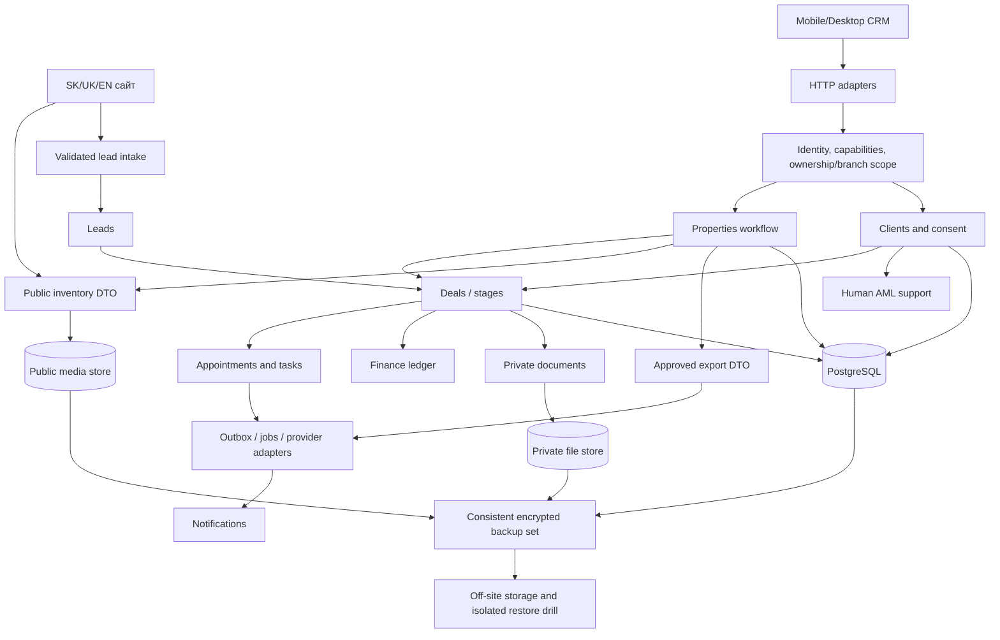

# Архітектура платформи 2.0

Рішення ADR-001: **модульний моноліт** на наявному Next.js App Router, одна PostgreSQL і окремий worker-процес лише коли з'являться jobs. Це мінімізує дублювання, кількість deployable units і витрати на одному VPS. Три незалежні apps зараз додали б auth/API/DTO/CI складність без перевіреної потреби.

Публічний сайт (`/[locale]`), CRM (`/admin`) і HTTP API (`/api`) залишаються окремими адаптерами одного застосунку. `src/modules/<domain>/` є власником бізнес-правил. `src/lib` лишається compatibility/infrastructure шаром для поступової міграції; не створюємо дублікати старих реалізацій. `prisma/` — єдина схема й append-only SQL-міграції. `infrastructure/` — ізольовані test/staging/VPS/backup конфігурації. Невикористаних порожніх modules/packages не створюємо.

## Правила

- Один module owner на сутність і транзакційний workflow; UI не здійснює незалежну перевірку прав замість сервера.
- Route → session + permission + validation → module service → Prisma transaction → audit; повертається явний DTO.
- Між модулями передаються типізовані IDs/DTO. Прямий cross-module write заборонено для нових модулів; orchestration належить workflow service.
- Нові async інтеграції використовують transactional outbox, idempotency key, retries і журнал. Зовнішній HTTP не виконується всередині довгої DB transaction.
- Публічний DTO не містить Client/AML/комісій/власників/приватних документів. Сховище приватних файлів окреме від `/uploads`.
- Гроші нових фінансових сутностей — minor-unit integers або Decimal з явним rounding; існуючий Property.price у цілих EUR не змінюється без міграції/контракту.
- APP_ENV відокремлюється від NODE_ENV. Production-оптимізація Next.js не означає production dataset. Test має власні БД, порт, build directory і media.
- Optimistic version preconditions для редагування, database locks/constraints для бронювання й фінансової нумерації. Offline PII не кешувати за замовчуванням.
- Нові capabilities — deny by default. Сім ролей і branch scope реалізовано в етапі A; legacy MANAGER зберігає company scope для сумісності.
- Code migrations: expand → backfill → contract, forward-compatible release, backup/restore gate. Автоматичного rollback SQL через git reset немає.

## Власники модулів і залежності

| Власник / модуль     | Поточний код / ціль                                     | Залежності                                        | Наступний контракт                       |
| -------------------- | ------------------------------------------------------- | ------------------------------------------------- | ---------------------------------------- |
| Identity & access    | `src/lib/security.ts` → `src/modules/access`            | User, Session, RateLimit, AuditLog                | capabilities, scope, TOTP                |
| Properties           | lib/catalog/properties + API → `src/modules/properties` | access, validation, media                         | moderation, versions, private/public DTO |
| Website CMS          | pages/i18n/Content/Settings                             | properties/public DTO                             | menu/banner/theme registry               |
| Clients              | наступний `src/modules/clients`                         | access, branches, consent                         | contacts, preferences, merge/export      |
| Leads                | API/leads + Lead                                        | access, properties; далі clients                  | idempotency, assignment, intake          |
| Deals                | наступний module                                        | clients, leads, properties, agents                | configurable stages, stage events        |
| Branches & agents    | modules/branches + identity/users                       | access, User                                      | branch scopes, reassignment              |
| Appointments & tasks | наступні modules                                        | deals, clients, agents                            | conflict-safe schedule, reminders        |
| Documents            | наступний module                                        | private storage, clients/properties/deals, access | versioned metadata, read audit           |
| Finance              | наступний module                                        | deals, agents, branches                           | commission ledger, invoices, tests       |
| AML                  | наступний module                                        | clients, documents, restricted access             | human review, retention, KYC             |
| Marketing            | наступний module                                        | approved property DTO, integrations               | feed preview, UTM, consent               |
| Integrations & jobs  | legacy `lib/crm.ts`, далі outbox/adapters               | OAuth/key custody, notifications                  | documented provider ports                |
| Analytics            | наступний module                                        | persisted domain events                           | scoped real aggregates, exports          |
| Notifications        | staff NEW count наразі                                  | jobs, calendar, leads                             | in-app inbox + optional mail adapter     |
| Backups/operations   | наступні scripts/infrastructure                         | consistent DB/files snapshot, encryption, S3      | admin status, restore drill, RPO/RTO     |

Вузли майбутніх модулів на схемі не означають їхню реалізацію. Стан кожного — у FEATURE_MATRIX. Критичні потоки: moderation/versioned update; inquiry→lead→client/deal; appointment locking; invoice numbering; consistent backup+restore. Кожен додається окремим перевіреним PR.

Етап A: `modules/identity` володіє users/tokens/TOTP/one-use factor consumption; `modules/branches` — branch lifecycle/active-branch lock. HTTP identity adapter — `/api/identity/[action]`; security UI окремо від generic business editor. Деталі: architecture/IDENTITY_API.md та security/IDENTITY_REVIEW.md.
