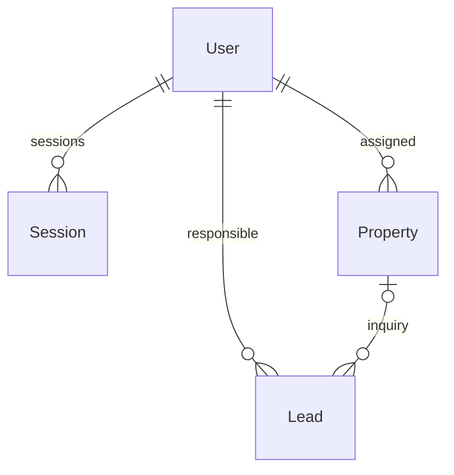

# Поточна база даних

Джерело істини: `prisma/schema.prisma`, SQL у `prisma/migrations`. PostgreSQL, Prisma pg adapter; міграції застосовує `scripts/migrate.ts` з lock, checksum і транзакцією. Застосовані файли не редагувати.

| Модель    | Дані та обмеження                                                                                                                          |
| --------- | ------------------------------------------------------------------------------------------------------------------------------------------ |
| User      | unique email, bcrypt passwordHash, ADMIN/MANAGER/AGENT, active, публічні bio/phone/avatar                                                  |
| Session   | hash token як id, user FK cascade, expiresAt index; raw token тільки в cookie                                                              |
| Property  | unique slug, локалізовані JSON translations/seo, характеристики, integer price EUR, media URL arrays, assigned user, demo, status, version |
| Lead      | контакт, message/kind/locale, consentAt/privacyVersion, відповідальний агент, nullable property FK set-null, notes, status                 |
| Content   | unique slug, kind, translations/SEO JSON, published                                                                                        |
| Settings  | singleton site, brand/contact, retentionDays                                                                                               |
| AuditLog  | actorId (без FK), action/resource/resourceId, metadata JSON, createdAt                                                                     |
| RateLimit | key, count, expiresAt index; спільний PostgreSQL rate limiter                                                                              |

`202610290001_property_review`: додає REVIEW, version=1 та audit metadata={}; без видалення або перейменування наявних полів. PATCH/DELETE Property потребують поточної version; умовний запис і audit відбуваються в одній транзакції. Price/status changes зберігаються в audit metadata, але це ще не окрема повна revision/price-history модель.

Немає таблиць Client, Deal, Calendar, Document, Finance, AML або Backup. Lead не називати повною CRM клієнтів. Сім ролей і branch scope додані в етапі A; MANAGER лишається legacy compatibility. JSON translations мають fallback до SK; приватні майбутні поля не включати до public DTO.

## 202610290002_enterprise_identity

Additive migration додає Branch, AccountToken, LoginEvent; User.branchId + encrypted MFA/pending, monotonic counter/recovery hashes/authVersion; Property.branchId і Lead.branchId. Existing users/properties/leads лишаються з null branchId без вигаданого backfill, старі ролі не змінюються. Нові enum values додаються, не використовуються в тій самій міграційній транзакції. FK Branch onDelete Restrict, AccountToken/User Cascade, LoginEvent/User SetNull. Індекси branchId та token/user/login time.

Branch: name/address/city/phone/email/active/publicContact/commissionBps/version/timestamps. Менеджер — User.role=BRANCH_MANAGER + branchId, працівники — той самий FK. PublicContact є persisted setting, публічна сторінка філій ще не реалізована. CommissionBps — налаштування, не готовий finance calculation.

AccountToken: SHA256 id, kind INVITE/RESET, user/authVersion/expiry; raw token не зберігається. LoginEvent: nullable userId, success/reason/time без паролів, email або IP. `data:purge` очищає expired tokens і login events за configured retentionDays.
